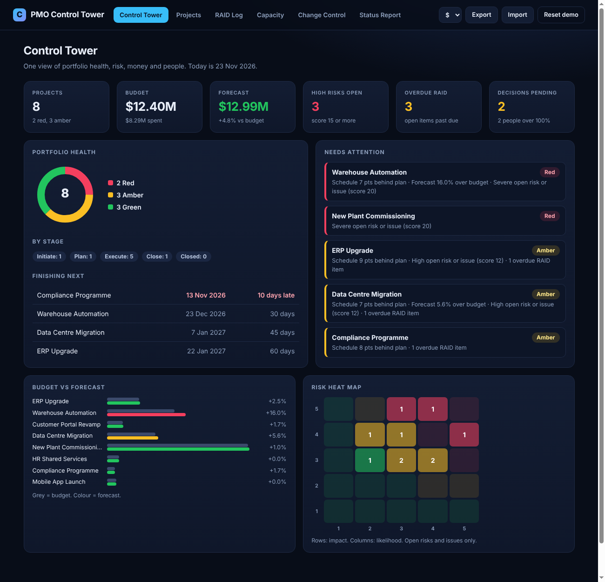

# PMO Control Tower

**One screen for everything a PMO needs to know.** Portfolio health, risks, budget, capacity and pending decisions, with a status report you can paste into an email.

No install. No build. No server. No data leaves your browser.



**Live demo:** `https://HeASailor.github.io/pmo-control-tower/` (GitHub Pages, deployed from main)

## Why

Most PMOs run on five spreadsheets and a lot of chasing. Status is a feeling ("I think it's amber"), risks live in someone's inbox, and nobody notices that the same architect is booked at 120% across three projects until a deadline slips.

Control Tower does the boring part automatically so the PMO can spend its time on decisions.

## What it does

| View | What you get |
|---|---|
| **Control Tower** | KPIs, portfolio health donut, "needs attention" list with reasons, budget vs forecast per project, risk heat map |
| **Projects** | Every project with a **calculated** RAG status, progress against plan, and variance |
| **RAID Log** | Risks, assumptions, issues and dependencies, scored 1-25, with overdue flags and filters |
| **Capacity** | Person x month allocation heatmap. Over 100% is overloaded, over 85% is stretched |
| **Change Control** | Change requests with approve/reject. Approving updates the forecast and end date automatically |
| **Status Report** | A ready-to-send markdown summary for the whole portfolio or a single project |

## RAG status is calculated, not guessed

Each project gets the worst rating produced by these rules:

| Signal | Amber | Red |
|---|---|---|
| Schedule (% complete vs % planned by dates) | more than 5 points behind | more than 15 points behind |
| Cost (forecast vs budget) | more than 5% over | more than 10% over |
| Open risk or issue (likelihood x impact) | score 12 or more | score 20 or more |
| RAID hygiene | any overdue open item | n/a |

Hover a status chip to see exactly why it has that rating. Completed projects are always green. The thresholds live in one function, `projectRag` in `js/core.js`, so changing them to match your organisation is a one-line edit.

## Run it

```bash
git clone https://github.com/HeASailor/pmo-control-tower
cd pmo-control-tower
open index.html          # or: npm start  ->  http://localhost:8080
```

The app opens with a synthetic demo portfolio. Click **Reset demo** any time to restore it, or start adding your own projects.

## Put it online (GitHub Pages)

1. Push the repo to GitHub.
2. Go to **Settings > Pages**, and under **Build and deployment** choose **GitHub Actions**.
3. The included workflow deploys on every push to `main`. Your demo link appears in the Actions run.

## Your data

- Everything is stored in your browser's `localStorage`. Nothing is sent anywhere.
- **Export** downloads the whole workspace as JSON. **Import** loads it back, so you can share a snapshot or move between browsers.
- Clearing browser data clears the workspace, so export before you do.

## Project layout

```
index.html            app shell
css/style.css         styling
js/core.js            pure logic: RAG, capacity, change control, reports (no DOM)
js/sample-data.js     synthetic demo portfolio, dates relative to today
js/app.js             UI and event handling
tests/core.test.js    unit tests for the logic
```

## Tests

```bash
npm test
```

Uses Node's built-in test runner (Node 18+), so there is nothing to install. The tests cover the RAG thresholds (including boundary cases), change application, capacity flags, portfolio rollups and report content.

## Roadmap

- [ ] Milestone tracking and critical-path view
- [ ] Benefits register
- [ ] CSV import from Jira / Excel
- [ ] Configurable RAG thresholds in the UI
- [ ] Print-friendly steering committee pack

## About the data

All demo data is fictional. No real project, client or employer data is included.

## License

MIT
